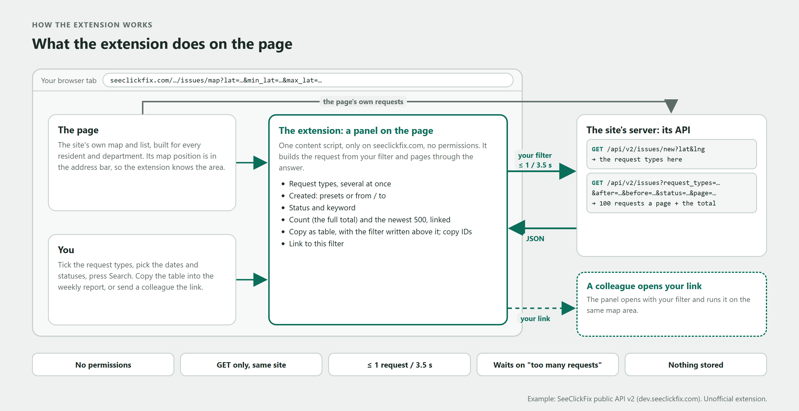

# Request filter for SeeClickFix (unofficial)

A small browser extension that adds a filter panel to [SeeClickFix](https://seeclickfix.com) pages. SeeClickFix is a 311 site: residents report potholes, graffiti and missed bins, and city teams work through the requests every day. Its public pages filter by keyword and status. This panel adds what a team doing the same task every morning usually needs:

- **several request types at once**, searchable, grouped by department;
- **a date range** on when the request was created (presets or from / to);
- **statuses** and a **keyword**;
- **a count and a list**, newest first, each linking to the request;
- **copy as table** (with the filter used written above it) and **copy IDs**;
- **a link to this filter**: whoever opens it gets the same panel, run on the same map area.



It was built with [Claude Code](https://claude.com/claude-code) and the [Chrome DevTools MCP server](https://github.com/ChromeDevTools/chrome-devtools-mcp): Claude opened the site, watched which requests the page itself makes, and wrote the extension around the same API. The article that walks through it: *(link added when published)*.

## Install (Edge or Chrome)

1. Download this repository (Code → Download ZIP) and unzip it.
2. Open `edge://extensions` (or `chrome://extensions`) and turn on **Developer mode**.
3. Choose **Load unpacked** and pick the `extension` folder.
4. Open a city's request map, for example New Haven: seeclickfix.com/new-haven → *View Requests*. The **Request filter** button sits bottom right.

## How it works

- **Only on SeeClickFix, with no permissions.** One content script, on `https://seeclickfix.com/*`. It can do only what the page itself can do.
- **The site's own public API.** It asks `/api/v2/issues/new` for the request types at the map's position and `/api/v2/issues` for the requests, with the filters you chose. These are the same kinds of calls the page makes, documented at [dev.seeclickfix.com](https://dev.seeclickfix.com).
- **Read-only.** GET requests only. It never creates, changes or comments on anything, and it stores nothing.
- **Polite.** At most one request every 3.5 seconds (the API allows 20 a minute), 100 requests per page, and it waits when the site says "too many requests". The list shows the newest 500; the count is always the full total.
- **The area is the map's.** The panel searches the area the page's map is showing. Move the map, then search again.
- **Dates are whole days** in your browser's time zone.

## Limits

- Unofficial: not affiliated with SeeClickFix or CivicPlus. If the site changes its API, the panel may stop working.
- Data: SeeClickFix data is licensed [CC BY-NC-SA 3.0 US](https://dev.seeclickfix.com), with attribution to seeclickfix.com. Occasional queries for your own use are fine; for large-scale reuse, SeeClickFix asks you to contact them first.
- Some request types and details are only visible to signed-in city staff; the panel sees what the public API returns.

## Build one for a site your team uses

The same approach works on any site whose page gets its data from an API, which most modern sites do. With Claude Code and the Chrome DevTools MCP server installed, a prompt like this gets you a first version:

```text
I use [site] every day to [the task, e.g. find last week's open requests of three types].
Its filters make that slow: [what you click today].

1. Open [the page] in the browser, do the task once the slow way, and list the network requests the page makes.
   Find the API calls behind the list and the filters, and show me what each returns.
2. Write a Manifest V3 extension for Edge/Chrome: one content script on [site], no permissions,
   GET requests only to the same site, at most one request every few seconds, and a panel with
   [the filters I need], a count, a list with links, "copy as table" and a link that re-runs the filter.
3. Check the panel's count against one direct API call for the same filter.
4. Tell me how to load it unpacked.
```

It won't fit every site: if the page has no API behind it, an extension has to read the page itself, which breaks easily, and the better step is to ask the site's developers for one.

## Licence

Code: MIT (see [LICENSE](LICENSE)).
